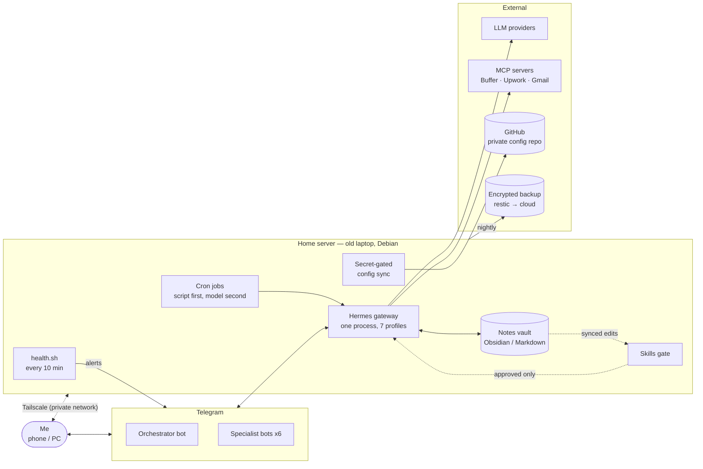

# Hermes Bot Team

A personal team of seven AI agents running 24/7 on an old laptop at home. Each bot has one job,
its own Telegram chat, its own schedule and its own limits — and none of them can send, post or
apply for anything without my approval.

Built on [Hermes Agent](https://github.com/NousResearch/hermes-agent) (Nous Research).

> **How this was built:** the code in this repository was written by AI coding agents
> (Hermes Agent and Claude Code). My part was designing the team, writing the rules and
> boundaries each bot works under, making the decisions, and testing everything in daily use.
> I'm a support/operations person, not a software engineer — this repo is a record of
> directing agents, not of hand-written code.

---

## The team

| Bot | Job | Runs | Can it act on its own? |
|---|---|---|---|
| **Orchestrator** ("CEO") | Main chat, routes work to specialists, evening team summary, keeps an eye on cron health | Weekdays 18:30 + on demand | Notes and summaries only |
| **Job Seeker** | Morning job-mail digest, career-page watcher, recruiter reply watcher, phishing score for mail, weekly application goal | Daily 07:45–23:00 | Writes Gmail **drafts** only — never sends, never applies |
| **Morning News** | Daily news + tech digest with source links, calendar line, content ideas | Daily 08:30 | Read-only |
| **Fantasy** | Fantasy NBA league: injury watch, daily waiver suggestions, trade analysis | Every 30 min + daily 11:00 | Suggestions only — never touches the roster |
| **NAS** | Server health, backups, weekly notes-vault maintenance, broken-link patrol, monthly account-security check | Weekly / monthly | Routine diagnostics; anything destructive needs approval |
| **Content** | Social media: ideas, scripts, short-video production, publishing packages via Buffer | Weekly plan + daily stats | Drafts only — nothing is scheduled or posted without an explicit OK |
| **Freelance** | Finds small gigs, drafts proposals and deliverables | Weekly opportunity check | Read-only on the marketplace; I submit everything myself |

Example personas: [`examples/profiles/`](examples/profiles/) · Example schedules: [`examples/crons.sh`](examples/crons.sh)

## Architecture



- **One gateway, seven profiles.** Each bot is a Hermes profile with its own persona (`SOUL.md`),
  config, memory, skills, cron jobs and Telegram bot token, multiplexed through a single gateway process.
- **Notes vault as long-term memory.** An Obsidian vault (Markdown + git) holds the real state of my
  life admin. Bots read it; unattended bots may only write *new* files into an inbox folder.
- **Private network only.** Dashboards and SSH are reachable over Tailscale; nothing admin-facing is
  exposed to the internet.

## Design rules

These are the parts I actually spent time on — the code follows from them.

1. **Human in the loop for anything external.** Sending mail, posting, applying, submitting proposals,
   changing a fantasy roster: bots prepare, I press the button. MCP write tools are disabled where
   they aren't needed (e.g. the freelance marketplace connection is read-only).
2. **Script first, model second.** Most cron jobs start with a deterministic collector script
   (fetch mail, scrape a page, check stats). If the script finds nothing new, the model isn't called
   and no message is sent. Quiet days cost nothing and don't spam me.
3. **Cheap model for routine work.** Scheduled jobs run on a small, inexpensive model; the bigger
   model is used in interactive chats where quality matters.
4. **One owner per credential.** Each OAuth connection (Buffer, marketplace, Gmail) belongs to
   exactly one bot. A bot that doesn't need a credential doesn't get it.
5. **No silent prompt injection via synced notes.** Skills (reusable procedures) live in the notes
   vault, which syncs from my phone and PC. Bots don't load them directly — a [skills gate](tools/skills-gate/)
   holds changes until I approve the diff.
6. **Secrets never reach git.** Config is synced to a private repo through a
   [three-gate pipeline](tools/secret-gate/): allowlist + masking, a check for *known real secret values*,
   then gitleaks. If any gate trips, nothing is pushed and I get an alert.
7. **Fits the hardware.** Services stay under ~5 GB RAM, heavy jobs run at night, no local LLM.
8. **Silence means healthy.** [`health.sh`](tools/health/) checks temperatures, disk SMART, RAM, network,
   DNS and backups every 10 minutes and only messages me when something is wrong (deduplicated for 6 h).
9. **The notes vault is the shared memory between agents.** Claude Code on my desktop and the bots
   on the server can't see each other's memory. One short shared note covers standing decisions,
   the machine map and who does what, and every agent reads it at the start of a session.
   Both sides' chat logs are exported to the vault every hour by plain scripts (no model), so
   "I told the other agent about this" can be looked up. An archived reply doesn't count as
   proof that something was done; the canonical note does.
10. **Subscriptions only through their official clients.** A consumer AI subscription is used
    through the vendor's own CLI ([`agy-bridge`](tools/agy-bridge/)), never by moving its login
    into another tool.

## Hardware & stack

| | |
|---|---|
| Machine | 2016 laptop (i7-6500U, 8 GB RAM, 1 TB HDD, Wi-Fi), lid closed, battery as a built-in UPS |
| OS | Debian 13 |
| Agent framework | Hermes Agent — gateway, profiles, cron, skills, MCP |
| Models | Mix of hosted providers; small model for cron, larger for chat; Gemini through the official Antigravity CLI on the desktop |
| Messaging | Telegram (one bot per profile) |
| Network | Tailscale; Caddy for tailnet-only HTTPS dashboards; AdGuard Home as tailnet DNS |
| Notes | Obsidian vault, synced with Syncthing, auto-committed to git every 15 min |
| Backup | restic (encrypted) → cloud drive nightly, 7 daily / 4 weekly / 6 monthly |
| Monitoring | `health.sh` + Telegram alerts, external heartbeat |

## What's in this repo

```
examples/
  profiles/<bot>/SOUL.md   generalized personas and rules for each bot
  crons.sh                 how the schedules are created (hermes cron create …)
tools/
  secret-gate/             leakcheck.py + sync.sh — push config to git only if no secret leaks
  skills-gate/             gate.py — approval gate between synced skills and live bots
  health/                  health.sh + notify.sh — 10-minute health check with deduplicated alerts
  agy-bridge/              pc-agy — run the Antigravity (Gemini) CLI on the desktop from the server
```

The tools are small and standalone; paths are configurable through environment variables.
My real configuration lives in a separate private repository.

## Lessons so far

- **Narrow bots beat one big assistant.** A bot with one job and a short rule list stays on task;
  out-of-scope requests get a one-line answer and a pointer to the right bot.
- **Write the boundaries down, in the persona.** "Drafts only", "never post without OK",
  "ask before anything destructive" — explicit rules in `SOUL.md` held up better than hoping the model
  would be careful.
- **Most value comes from boring scripts.** The model is the last step; reliable collectors and
  "say nothing if nothing changed" made the team usable day to day.
- **Treat synced text as untrusted input.** Anything that can change outside the server (notes,
  mail, web pages) goes through a gate or is read, never executed.
- **Don't update the agent from inside the agent.** A `hermes update` started from a chat (even
  inside tmux) lives in the gateway's process group. The gateway restart then kills it halfway,
  and the install is left with a stale lock and one service still running old code.
  `systemd-run --user` puts it outside the gateway, so the restart can't touch it.
- **"It forgets what I said" wasn't a compression problem.** With a 1M-token model, a 50 %
  compression threshold is already 500K tokens, so raising it only makes every reply more
  expensive. The real fix was starting a new session when the topic changes.
- **Upgrade cron models on evidence.** When one daily digest contradicted another, I moved that
  single job to the big model and compared one run side by side before deciding. The other
  jobs stayed on the small model.

## License

MIT — see [LICENSE](LICENSE).
